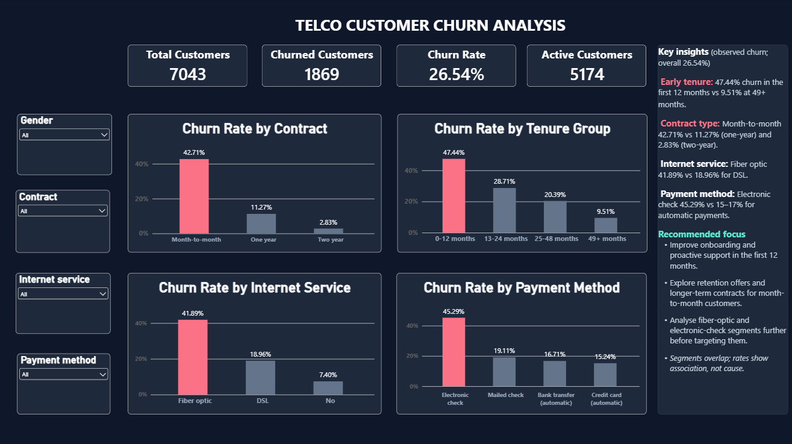

# Telco Customer Churn Analysis

**Who is leaving a telecom company, and why should it matter?**

I analyzed 7,043 customers with Excel, MySQL and Power BI. **1,869 left (26.54%).**

## What I Found

Customers left the most in these groups:

- **New customers (0–12 months):** 47.44% left, compared with 9.51% for customers with 49+ months
- **Electronic check payers:** 45.29% left
- **Month-to-month contracts:** 42.71% left, compared with 2.83% on two-year contracts
- **Fiber-optic internet:** 41.89% left, compared with 18.96% for DSL

## What I Recommend

1. Help new customers more in their first 12 months.
2. Look into offers that move month-to-month customers to longer contracts.
3. Study fiber-optic and electronic-check customers more before acting.

## What I Did

1. **Excel:** cleaned the data and checked for duplicates, missing values and valid churn labels. Set 11 blank `TotalCharges` values to 0, because those customers had zero tenure.
2. **MySQL:** checked my findings and calculated churn by contract, tenure, internet service and payment method.
3. **Power BI:** built an interactive dashboard with KPI cards, four churn charts and filters.

These are observed rates. Further analysis is needed to understand the reasons behind them.

## Files

- `Excel/`: data cleaning and first analysis
- `SQL/`: queries
- `PowerBI/`: dashboard
- `Raw_Data/` and `Cleaned_Data/`: datasets
